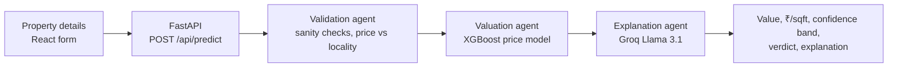

# IntelliValue — AI Property Valuation for Indore

IntelliValue estimates the fair market value of a residential property in Indore. A user enters the property's details; a three-step agent pipeline validates the input, predicts the price with an XGBoost model trained on Indore locality data, and uses an LLM to explain in plain language what drove the valuation — including whether the asking price looks over- or under-valued.

---

## How it works



1. **Validation agent** — flags unrealistic inputs (e.g. a 3 BHK under 600 sq ft, more than 5 BHK, an apartment over 8,000 sq ft) and listing prices far outside the locality's range, and sets a confidence level.
2. **Valuation agent** — engineers features and runs the XGBoost model to predict total value and price per sq ft, adds a ±5% confidence band, and compares the result with the locality average to give a verdict.
3. **Explanation agent** — sends the prediction and key factors to an LLM on Groq for a 3–4 sentence explanation, with a rule-based fallback if the LLM is unavailable.

## Model

| | |
|---|---|
| Algorithm | XGBoost regressor on log-transformed price |
| Data | 900 cleaned records across 26 Indore localities (`Dataset/indore_full_dataset.csv`) |
| Features | 19 — area, BHK, locality, distance to city centre, coordinates, registry (circle) rate, market rate, listing rate, property age, amenities, facing, road connectivity, crime level, upcoming projects, owner vs broker, property type |
| Split | 80 / 20 train–test (720 / 180) |
| Explainability | SHAP values and feature-importance plot generated during training |

Test-set results from running `Dataset/train_model.py`:

| MAE | RMSE | R² | MAPE | 5-fold CV R² |
|---|---|---|---|---|
| ₹1.14 lakh | ₹1.64 lakh | 0.996 | 2.2% | 0.994 ± 0.003 |

> Market and listing rates per sq ft are input features, so the model learns how a specific property should be priced relative to its area's going rate. The dataset combines collected locality data with records generated from MP IGRS circle rates and market research (`Dataset/genrate_dataset.py`).

## Features

- Valuation form for 26 Indore localities with property, location and neighbourhood attributes
- Predicted value, price per sq ft, confidence band and over/under-valuation verdict
- Natural-language explanation of the valuation
- Input validation warnings
- Sign-up / login with bcrypt-hashed passwords and JWT

## Tech stack

- **ML:** XGBoost, scikit-learn, pandas, NumPy, SHAP
- **Backend:** Python, FastAPI, SQLAlchemy (SQLite), python-jose (JWT), passlib/bcrypt, Groq
- **Frontend:** React, Vite, Tailwind CSS, Framer Motion, Axios
- **Data collection:** Playwright + BeautifulSoup scraper for 99acres listings

## API

| Method | Endpoint | Purpose |
|---|---|---|
| POST | `/api/auth/signup` | Create an account |
| POST | `/api/auth/login` | Get a JWT |
| GET | `/api/auth/me` | Current user |
| POST | `/api/predict` | Validate, value and explain a property (requires `Authorization: Bearer <token>`) |
| GET | `/api/localities` | Supported localities with circle and market rates |
| GET | `/api/health` | Health check |

## Run locally

**Backend**

```bash
cd backend
python -m venv venv
source venv/bin/activate        # Windows: venv\Scripts\activate
pip install -r requirements.txt
uvicorn main:app --reload --port 8000
```

Create `backend/.env`:

```env
GROQ_API_KEY=your_groq_key        # optional — falls back to a template explanation
JWT_SECRET_KEY=a_long_random_string
```

The SQLite user database is created automatically on first start.

**Frontend**

```bash
cd frontend
npm install
npm run dev
```

The Vite dev server proxies `/api` to `http://localhost:8000`.

**Retrain the model (optional)**

```bash
cd Dataset
pip install pandas numpy scikit-learn xgboost shap matplotlib
python train_model.py
```

This overwrites `property_valuation_model.pkl`, `label_encoders.pkl` and `feature_names.json`, and writes `feature_importance.png` and SHAP plots.

## Project structure

```
├── backend/
│   ├── main.py            FastAPI app and /api/predict pipeline
│   ├── agents/            validation, valuation and explanation agents
│   ├── model/predictor.py model loading and feature preparation
│   ├── auth/              signup, login, JWT
│   └── config.py          locality circle and market rates
├── frontend/              React + Vite app (src/pages: Home, Valuate, About, Login…)
├── Dataset/               data, generator, 99acres scraper, training script, trained model
└── doc/                   technical documentation (.docx)
```
